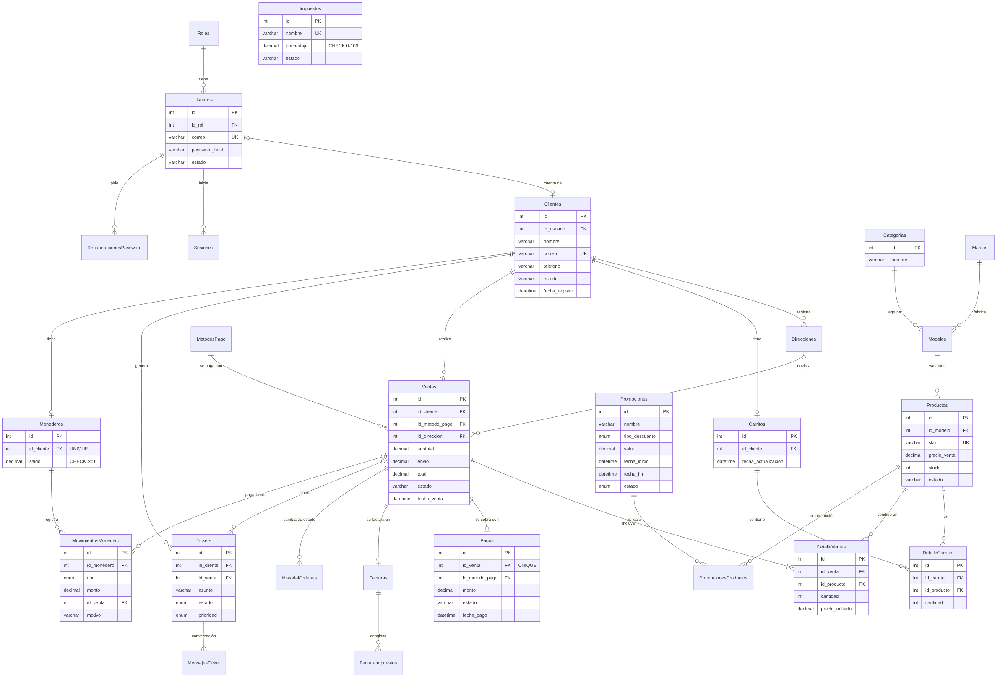

# Base de datos de SporTenis (Etapa 4 · 4.2)

Diseño lógico y físico de la base de datos MySQL que soporta la tienda en línea, el CRM, el SCM y el ERP.
El esquema vive en `src/db/schema.ts` (Drizzle ORM) y cada cambio tiene su migración en `db/migrations/`.



> El diagrama se genera desde `docs/diagrama-er.mmd` (Mermaid). Si se cambia una tabla, se actualiza ese archivo y se vuelve a generar la imagen con `npx -p @mermaid-js/mermaid-cli mmdc -i docs/diagrama-er.mmd -o docs/diagrama-er.png -w 2400 -b white`.

## 1. Tablas que pide el documento y dónde están

| Tabla del documento | Tabla real | Para qué sirve |
|---|---|---|
| clientes | `Clientes` | Datos del cliente: nombre, correo único, teléfono, estado, fecha de registro |
| usuarios | `Usuarios` + `Roles` | Cuenta de acceso con contraseña cifrada y rol (cliente, vendedor, logística, administrador) |
| productos | `Productos` (+ `Modelos`, `Marcas`) | Cada variante (talla y color) con SKU único, precio, costo y stock |
| categorias | `Categorias` | Categoría del modelo (tenis, pádel, accesorios…) |
| carrito | `Carritos` | Carrito guardado del cliente |
| carrito_detalle | `DetalleCarritos` | Productos y cantidades dentro del carrito |
| pedidos | `Ventas` | Pedido con totales, estado, método de pago y dirección de envío |
| pedido_detalle | `DetalleVentas` | Productos del pedido con el precio al que se vendieron |
| pagos | `Pagos` | Cobro del pedido: monto, método, estado, fecha y referencia |
| promociones | `Promociones` + `PromocionesProductos` | Descuento por porcentaje o monto, con vigencia, y los productos a los que aplica |
| impuestos | `Impuestos` + `FacturaImpuestos` | Impuestos configurables y su desglose guardado en cada factura |
| tickets_atencion | `Tickets` + `MensajesTicket` | Solicitudes de soporte del cliente y su conversación con el equipo |

Tablas de apoyo del mismo flujo: `Facturas`, `MetodosPago`, `Direcciones`, `HistorialOrdenes`, `Monederos`, `MovimientosMonedero`, `Sesiones` y `RecuperacionesPassword`.

## 2. Relaciones

| Relación del documento | Cómo se cumple en la base |
|---|---|
| Un cliente puede tener varios pedidos | `Ventas.id_cliente` → `Clientes.id` (1 a N) |
| Un cliente puede tener un carrito | `Carritos.id_cliente` → `Clientes.id`. `lib/cart.ts` siempre usa el primer carrito del cliente y solo crea otro si no tiene ninguno |
| Un carrito tiene muchos productos | `DetalleCarritos.id_carrito` → `Carritos.id` y `DetalleCarritos.id_producto` → `Productos.id` |
| Un pedido tiene muchos detalles | `DetalleVentas.id_venta` → `Ventas.id` (1 a N) |
| Un pedido tiene un pago | `Pagos.id_venta` → `Ventas.id` con **UNIQUE**: la base no permite dos pagos para el mismo pedido |
| Un cliente puede generar varios tickets | `Tickets.id_cliente` → `Clientes.id` (1 a N); `Tickets.id_venta` es opcional para ligar el ticket a un pedido |
| Un producto pertenece a una categoría | `Productos.id_modelo` → `Modelos.id` y `Modelos.id_categoria` → `Categorias.id` |

Otras relaciones del negocio:

- Una promoción aplica a muchos productos y un producto puede estar en varias promociones (N a N con `PromocionesProductos`, cuya llave primaria es `(id_promocion, id_producto)`).
- Un pedido tiene una factura (`Facturas.id_venta` UNIQUE), y la factura guarda el desglose de cada impuesto en `FacturaImpuestos`.
- Un cliente tiene un monedero (`Monederos.id_cliente` UNIQUE) y cada movimiento queda en `MovimientosMonedero`; si el movimiento pagó un pedido, apunta a `Ventas`.
- Cada cambio de estado de un pedido queda en `HistorialOrdenes` con el usuario que lo hizo.

## 3. Integridad referencial

Todas las relaciones son llaves foráneas reales en MySQL (InnoDB). Qué pasa al borrar un registro depende de lo que necesita el negocio:

| Llave foránea | Al borrar el padre | Por qué |
|---|---|---|
| `Ventas.id_cliente`, `DetalleVentas.id_venta`, `Pagos.id_venta` | Se impide (RESTRICT) | Un pedido pagado nunca debe quedar huérfano ni perderse |
| `Ventas.id_direccion` | `SET NULL` | El pedido conserva una copia de la dirección en `direccion_envio`, aunque el cliente la borre o la edite |
| `MensajesTicket.id_ticket` | `CASCADE` | Los mensajes no tienen sentido sin su ticket |
| `PromocionesProductos` (ambas) | `CASCADE` | Si se borra la promoción o el producto, desaparece el vínculo |
| `MovimientosMonedero.id_monedero` | `CASCADE` | El historial pertenece al monedero |
| `Sesiones.id_usuario`, `RecuperacionesPassword.id_usuario` | `CASCADE` | Si se borra la cuenta, sus sesiones y enlaces dejan de existir |
| `Tickets.id_usuario_asignado`, `MovimientosMonedero.id_usuario` | `SET NULL` | Si se da de baja a un empleado, el ticket o el ajuste se conservan |

## 4. Restricciones

**Únicas:** `Usuarios.correo`, `Clientes.correo`, `Productos.sku`, `Impuestos.nombre`, `Facturas.folio`, `Facturas.uuid`, `Pagos.id_venta`, `Facturas.id_venta`, `Monederos.id_cliente`, `Sesiones.token_hash` y `RecuperacionesPassword.token_hash`.

**CHECK:**
- `Impuestos.porcentaje` entre 0 y 100 (`chk_impuestos_porcentaje`).
- `Monederos.saldo >= 0` (`chk_monederos_saldo`): el saldo nunca queda en negativo, aunque alguien escriba directo en la base.

**ENUM:** limitan los valores válidos:
- `Promociones.tipo_descuento` (porcentaje o monto) y `Promociones.estado`;
- `Tickets.estado` (Abierto, En proceso, Resuelto o Cerrado) y `Tickets.prioridad`;
- `MensajesTicket.autor`;
- `MovimientosMonedero.tipo` (Recarga, Descuento, Reembolso, Retiro, Canjeo, RecargaTarjeta, AjusteAbono o AjusteCargo).

**NOT NULL** en todos los datos que el flujo necesita: totales, precios, cantidades, fechas y estados.

## 5. Validaciones y consistencia en el servidor

La base es la última línea de defensa. Antes de llegar a ella, el servidor valida:

- **Precios:** siempre se leen del catálogo. Se ignora cualquier precio que mande el navegador (`api/ventas.ts`).
- **Stock:** el pedido descuenta el inventario con `UPDATE … SET stock = stock - n WHERE stock >= n` dentro de una transacción (`lib/ventas.ts`). Si dos clientes compran la última pieza al mismo tiempo, solo uno lo consigue y al otro se le avisa.
- **Monedero:** el cobro usa `WHERE saldo >= total` dentro de la misma transacción que registra la venta. Si no alcanza, no se guarda nada: ni la venta, ni el stock, ni la factura.
- **Carrito:** antes de mostrarlo se ajusta al stock actual. Se quita lo agotado y se baja lo que ya no alcanza (`ajustarAlStock`).
- **Contraseñas:** cifradas con hash y nunca en claro. Los tokens de sesión y de recuperación solo se guardan como hash SHA-256.
- **Correo único:** al registrarse, se verifica con un código antes de crear la cuenta.

## 6. Consultas para reportes

| Reporte | Dónde | Qué consulta |
|---|---|---|
| Ventas, productos más vendidos e inventario | `/erp/reportes` | `Ventas` + `DetalleVentas` + `Productos`, agrupado por periodo y producto |
| Finanzas (ingresos contra costo de lo vendido) | `/erp/finanzas` | `SUM(Ventas.total)` y costo por mes, solo pedidos Confirmados o Entregados |
| Presupuesto contra lo real | `/erp/presupuestos` | `Presupuestos` comparado con las ventas efectivas del periodo |
| Uso del monedero | `/erp/monedero` | `MovimientosMonedero` agrupado por mes y tipo; clientes que más pagan con monedero |
| Tickets de soporte | `/crm/tickets` | `Tickets` por estado y prioridad, con su pedido y cliente |
| Historial del cliente | `/cuenta/compras` | `Ventas` del cliente con su estado, pago y factura |

## 7. Cómo crear la base

```bash
npx drizzle-kit push   # crea las tablas desde src/db/schema.ts
npx tsx db/seed.ts     # datos de ejemplo
```

En una base que ya existe, se aplican las migraciones en orden (ver la lista en el `README.md`).
